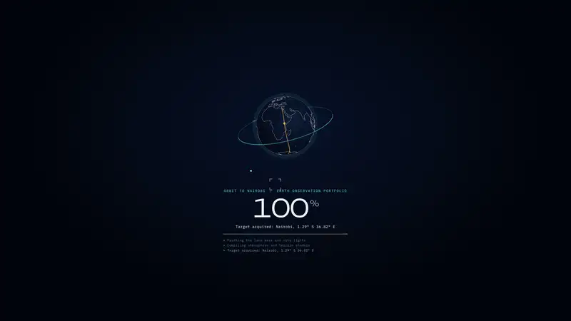

# Orbit Descent

An immersive portfolio template where every section is a satellite pass. Visitors start in orbit above a night-side Earth and scroll down through the atmosphere and the clouds until they land in your home city. A small satellite flies with the camera and paints a segmentation mask (water, vegetation, built-up land, slopes) over the ground as each section comes into view. Everything is drawn live in WebGL, with no downloaded models, textures or HDRIs. The demo person, Amara Nwosu, an Earth observation data scientist in Nairobi, is fictional, as are her companies and projects.

<p align="center">
  <a href="docs/preview.mp4"></a>
  <br>
  <sub>Click the preview to watch the full 40-second video (<code>docs/preview.mp4</code>).</sub>
</p>

**Use it:** click **Use this template** at the top of this page (or run `git clone https://github.com/Malaydoshi711/orbit-portfolio-template.git`), then follow [Quick start](#quick-start) and [Make it yours](#make-it-yours) below. Everything you need to change lives in `src/data/content.ts`.

## Features

- **Loader:** a mission boot with a small vector globe centred on your city, coastlines, an orbit ring and a ground track drawing in while the uplink counts up.
- **Hero:** high orbit over a night-side Earth with city lights, a cloud layer, a Fresnel atmosphere, a warm dawn crescent on the limb, a starfield and a procedural satellite. The cursor tilts the view.
- **Scan passes:** About, Experience and the flagship project each trigger a pass that sweeps a scan line and paints a classified raster near your city.
- **Research:** the camera pulls back to the hemisphere. As you scroll through publications and talks, arcs fly from your city to each venue that has coordinates, with pins and labels. Venues on the far side of the planet are fine: the camera follows the arcs. Entries without a city simply get no pin.
- **Flagship:** the parts of your main system (2 to 6) fly in formation around the satellite. The highlighted one follows the panel.
- **Re-entry:** a dive through a cloud layer, where the orbit world hands over to a procedural ground world.
- **Projects, toolkit, landing:** low flight over generated terrain (hills, river, an optional sea shore, the city's street grid at night), ground control markers, and a landing beacon on your coordinates.
- **HUD:** live altitude, latitude, longitude and pass number, section nav, and a dock with the agent, resume and Ctrl/Cmd + K.
- **Ask my agent:** a retrieval console that answers from your content, with an optional LLM.
- **Command palette:** Ctrl/Cmd + K to jump to sections, copy your email, grab the resume, open links or ask a question.
- Crosshair cursor on desktop, phone layout, reduced motion support, WebGL fallback and adaptive quality.

## Quick start

Requires Node 20.19+ or 22.12+ (Node 22 LTS recommended).

```bash
npm install
npm run dev       # development server
npm run build     # type-check and build into dist/
npm run preview   # serve the production build locally
```

## Make it yours

1. **Content.** Edit `src/data/content.ts`. It is the only file with personal data:
   - `profile`: name, pronouns (used by the agent), role, company, email, About headline and paragraphs, contact line.
   - `site`: URL, title, description, resume path, OG image, footer note, socials, and `home`, the city you land in. See [Set your home city](#set-your-home-city) below.
   - `experience`, `education`: newest first. The first job is highlighted; the first degree appears in About.
   - `projectClasses` and `projects`: each project belongs to a class, and each class picks one of four colour tones. Optional `metric`, `links`, `badge` and `aside`.
   - `featured`: your flagship system, with `parts` (name and one-line role each).
   - `publications`: papers or talks. Add `geo: { city, lat, lon }` to get an arc and a pin (see [Pins and arcs](#pins-and-arcs)). An empty list hides the section, and the nav adapts.
   - `skills`, `certifications`.
2. **Site URL.** Set `site.url` (with a trailing slash). The canonical link, Open Graph tags, JSON-LD, `sitemap.xml` and `robots.txt` are generated from it by the plugin in `vite.config.ts`.
3. **Resume.** Put your PDF in `public/` and point `site.resume` at it (default `/Resume.pdf`).
4. **Social image.** Replace `public/og.png` (1200 x 630). The easiest way: run the site, set the browser window to 1200 x 630, wait for the hero, take a screenshot.
5. **Icons.** Edit `public/favicon.svg` (it shows initials) and replace `public/apple-touch-icon.png` (180 x 180).
6. **Colours and fonts.** Tokens are at the top of `src/styles.css`. The WebGL world uses a matching palette in `src/world/palette.ts`; change both together. Fonts are imported in `src/main.tsx` from `@fontsource` packages.
7. **Footer note.** Set `site.footerNote` to an empty string to remove the "Sample portfolio" line.
8. **Optional LLM for the agent.** See below.

## Set your home city

The descent ends in your city. Everything on the way is placed relative to it: the camera path, the sun and the dawn on the horizon, the scan passes, the loader globe and its ground track, the HUD coordinates, the research arcs, the ground you fly over at the end and the landing beacon. Any city on Earth works, north or south, east or west.

It all lives in `site.home` in `src/data/content.ts`:

| Field | What it does |
| - | - |
| `city` | Shown in the loader, the hero, the research heading, the re-entry line, the landing panel, the footer and the agent's answers. |
| `country` | Shown next to the city in About, the footer and the agent's answers. |
| `countryCode` | Two-letter ISO code (`GB`, `JP`, `BR`) for the JSON-LD address search engines read. |
| `lat`, `lon` | Where you land, in decimal degrees. South and west are negative. |
| `timezone` | Free text such as `"GMT, UTC+0"`. The agent mentions it when asked where you are. Leave it empty to skip it. |
| `surroundings` | Ends the re-entry line: "The next passes are flown low, over ...". For example `"the hills above the bay"`. |
| `terrain` | The low-altitude ground after the re-entry. See below. |

**Finding your coordinates.** In Google Maps, Apple Maps or OpenStreetMap, right-click (or long-press) a spot in the middle of your city and copy its latitude and longitude. You want decimal degrees like `51.5072, -0.1276`, not degrees and minutes. The first number is `lat`, the second is `lon`. Places south of the equator have a negative latitude, places west of Greenwich have a negative longitude.

### Terrain options

| Option | Default | What it does |
| - | - | - |
| `ridgeBearing` | `270` | Compass bearing (0 north, 90 east, 180 south, 270 west) of the hills that rise beyond the city. `null` for no hills. |
| `terraced` | `true` | Flat-topped steps in the land, like an old lava plateau. Turn off for soft rolling land. |
| `river` | `true` | A river winding west to east through the city. |
| `relief` | `1` | How tall the land is: `0` flat, `1` rolling, `2` mountainous. |
| `coast` | `"auto"` | Compass bearing of the sea for a coastal city (the direction you would walk to reach the water), `null` for an inland city, or `"auto"` to guess it from the map. |

With a coast, the ground shows a shoreline on that side: dark water mirroring the dawn, the city's glow on the shallows, and lights that stop at the beach. The final approach turns so the sea opens up ahead of you. `"auto"` reads the built-in world map, which is only accurate to about 10 km, so it can miss a bay or an estuary. If it guesses wrong, or misses your coast, set the bearing yourself.

What to change for your kind of place:

- **Coastal** (Mumbai, Sydney, Lisbon, Cape Town): set `coast` to the bearing of the open water, and point `ridgeBearing` inland or set it to `null`.
- **Mountainous** (Denver, Quito, Kathmandu): `relief: 1.6` to `2`, `ridgeBearing` toward the main range, `terraced: false` for natural slopes.
- **Flat** (Chicago, Delhi, Amsterdam): `relief: 0.2` to `0.4`, `terraced: false`, `ridgeBearing: null`. Keep `river` if one runs through town.

### Examples

London, north of the equator and just west of Greenwich, by a river:

```ts
home: {
  city: "London", country: "United Kingdom", countryCode: "GB",
  lat: 51.5072, lon: -0.1276, timezone: "GMT, UTC+0",
  surroundings: "the Thames and the green belt around the city",
  terrain: { ridgeBearing: null, terraced: false, river: true, relief: 0.4, coast: null },
},
```

Sydney, south of the equator and far east, with the Pacific to the east:

```ts
home: {
  city: "Sydney", country: "Australia", countryCode: "AU",
  lat: -33.8688, lon: 151.2093, timezone: "AEST, UTC+10",
  surroundings: "the harbour and the sandstone ridges behind it",
  terrain: { ridgeBearing: 270, terraced: true, river: false, relief: 0.8, coast: 90 },
},
```

São Paulo, south and west, inland on a high plateau:

```ts
home: {
  city: "São Paulo", country: "Brazil", countryCode: "BR",
  lat: -23.5505, lon: -46.6333, timezone: "BRT, UTC-3",
  surroundings: "the plateau and the forested hills to the north",
  terrain: { ridgeBearing: 0, terraced: false, river: true, relief: 1, coast: null },
},
```

**Trying a city before you commit.** While `npm run dev` is running you can preview any city from the address bar, without editing anything: `http://localhost:5173/?home=35.68,139.69,Tokyo`. Add `&coast=135` (or `coast=none`) to try a coast, and `&venues=40.71,-74.0;51.5,-0.13` to move the publication pins. Production builds ignore these.

### Pins and arcs

Each publication with a `geo: { city, lat, lon }` gets a pin and an arc from your home city during the Research section. The arcs follow the shortest path over the globe, so they cross the date line or the poles when that is shorter, and they draw in one by one as the visitor scrolls through your entries. When all the venues fit on one side of the planet the camera frames them together; when they are spread wider (say a home in Honolulu and venues in Lisbon and Nairobi), the camera follows each arc in turn. Leave `geo` out for journals or online talks; those entries simply get no pin.

The world map is Natural Earth's 1:110m land, so very small islands are missing. Your home city always gets a patch of land and its own lights, even if the map is too coarse to show it.

## How "Ask my agent" works

The console in `src/components/Agent.tsx` runs a small pipeline over a knowledge base built from `content.ts` (`src/agent/kb.ts`): it classifies the question, retrieves the best matching chunks with BM25 plus a small synonym map, and writes an extractive answer with sources. It works offline, with no server.

If you deploy on Vercel, `api/ask.ts` can answer with any OpenAI-compatible model instead, using the same retrieval on the server and a system prompt generated from your content. Set:

- `LLM_API_KEY` (required to enable it)
- `LLM_BASE_URL` (optional, default `https://api.groq.com/openai/v1`)
- `LLM_MODEL` (optional, default `llama-3.3-70b-versatile`)
- `VITE_LLM=1` at build time, so the browser calls `/api/ask`

Without these, the agent keeps using its offline answers. You can add your own vocabulary in `site.agentSynonyms`.

## Deploy

- **Vercel:** import the repository, framework preset Vite, deploy, then add your domain under Settings, Domains. `vercel.json` sets caching and security headers.
- **Netlify:** build command `npm run build`, publish directory `dist`.
- **Any static host:** upload `dist/`. The agent then uses its offline answers only.

## Performance and accessibility

- Adaptive quality: if frames stay slow, the site drops bloom, then pixel ratio and glass blur.
- Phones get fewer stars and clouds, a lighter globe mesh, no post-processing and a simpler layout with a thumb-friendly dock and menu.
- `prefers-reduced-motion`: no smooth scrolling, no intro animation, scans appear instantly and all content is visible at once.
- If WebGL is unavailable, a styled static background is shown and every section stays readable.
- Add `?hq` to the URL to disable adaptive quality, `?nobloom` to skip bloom.

## Project structure

```
index.html              minimal shell; meta tags are injected from content
vite.config.ts          SEO plugin (head tags, sitemap, robots) and local /api/ask stub
api/ask.ts              optional LLM endpoint (Vercel Edge Function)
public/                 favicon, apple-touch-icon, og.png, Resume.pdf
src/data/content.ts     all personal content and site settings
src/App.tsx             page, HUD, scroll to descent mapping, section choreography
src/styles.css          layout and theme tokens
src/shared.css          cursor, agent console and palette styles
src/components/         Loader, Agent, Palette, Cursor
src/agent/kb.ts         knowledge base, retrieval and answer composition
src/world/World.ts      renderer, camera path, passes, labels, adaptive quality
src/world/route.ts      where each section sits along the descent
src/world/Globe.ts      night-side Earth, clouds, atmosphere, arcs and pins
src/world/Ground.ts     terrain, city lights, clouds, markers and beacon
src/world/Satellite.ts  procedural satellite and the flagship's parts
src/world/geo.ts        land mask painter, city lights, lakes, coast and sun helpers
src/world/land.ts       Natural Earth 1:110m coastlines (generated, compact)
src/devHome.ts          dev-only ?home= preview of another city
src/world/palette.ts    WebGL colours (keep in step with styles.css)
```

## Credits

Built with [Three.js](https://threejs.org/), [GSAP](https://gsap.com/), [Lenis](https://lenis.darkroom.engineering/), [React](https://react.dev/) and [Vite](https://vitejs.dev/). Fonts from [Fontsource](https://fontsource.org/): Unbounded, Instrument Sans and IBM Plex Mono. Coastlines from [Natural Earth](https://www.naturalearthdata.com/) 1:110m land (public domain), via the [world-atlas](https://github.com/topojson/world-atlas) package.

## License

MIT, see [LICENSE](LICENSE). You are free to use this template for your own portfolio, change it and publish it. The demo person, companies and projects are fictional.
